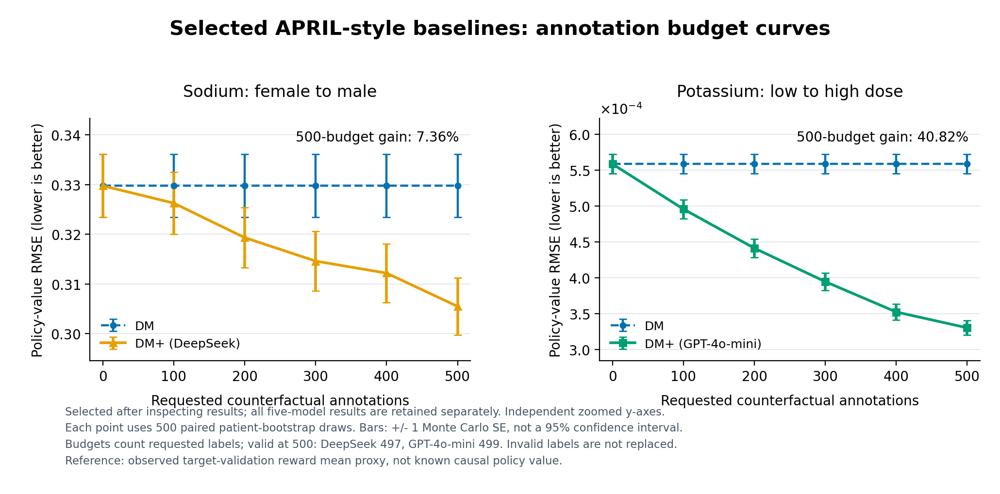

# Healthcare-OPE

An independent implementation and partial empirical reproduction of [APRIL: Annotations for Policy evaluation with Reliable Inference from LLMs](https://proceedings.mlr.press/v297/mandyam26a.html), focusing on offline policy evaluation for intravenous potassium and hypertonic saline treatment in MIMIC-IV 3.1.

The implementation compares the direct method (DM) with DM+, which augments a linear reward model with counterfactual rewards obtained by converting LLM predictions of post-treatment laboratory values through a fixed reward function. It retains a single-step contextual bandit formulation and evaluates policy-value estimates against an observed-reward reference.

**The Git checkout contains code, synthetic tests, and aggregate results. The complete restricted reproduction bundle is provided separately as an attachment to the [private baseline-data release](https://github.com/adlee1/Healthcare-OPE/releases/tag/baseline-data-2026-10-24).** A clone can run tests and render aggregate figures; both `cached` and `fresh` clinical reproduction require downloading and extracting that bundle. Access is limited to appropriately authorized collaborators covered by the repository owner's confirmed permission. See [data access](docs/DATA_ACCESS.md).

## Read the code and locate models

Start with the **[code navigation guide](docs/CODE_GUIDE.md)** for model locations, function calls, saved model files, and which program to run. The **[complete Python symbol index](docs/FUNCTION_INDEX.md)** links every named function, class, and method to its implementation. Detailed guides cover [model/evaluation code](docs/MODEL_CODE.md), [execution entry points](docs/RUNNERS.md), and [LLM configuration/adapters](docs/LLM_CODE.md).

The portable baseline runner imports frozen code from the downloaded bundle's `src/`. Editing this checkout's `src/` will not change that runner's numerical implementation; use a separate development entry point for a new method, as described in the code guide.

## Selected development baselines

These two cases were selected after inspecting the results. They are useful development baselines, not prospectively selected independent test sets.

| Case | Annotation source | Valid CF / 500 requests | DM RMSE | DM+ RMSE | Relative RMSE decrease |
|---|---|---:|---:|---:|---:|
| Sodium: female to male | DeepSeek | 497 | 0.329760607702 | 0.305482558895 | 7.362325% |
| Potassium: low-dose to high-dose patient groups | GPT-4o-mini | 499 | 0.000558455623 | 0.000330506060 | 40.817847% |

Each result uses 500 paired patient-bootstrap draws, with zero failed draws. Annotation budgets count fixed requested prefixes; invalid annotations are retained in the denominator and are not replaced. Dose-based groups are assigned at the patient level, so the high-dose group also contains zero- and lower-dose events.

The broader five-model aggregate results are retained alongside these selections. At the 500-request budget, 13 of 25 estimable model/configuration combinations have lower RMSE with DM+, and 12 have higher RMSE. Sodium dose-shift evaluation remains non-estimable because its target-validation population is empty.



The panels use separate vertical scales. Error bars show one Monte Carlo standard error, not a 95% confidence interval.

## Quick start: no clinical data required

```bash
git clone https://github.com/adlee1/Healthcare-OPE.git
cd Healthcare-OPE
python3.12 -m venv .venv
source .venv/bin/activate
python -m pip install -r requirements-g3.lock
python -m pip install -r requirements-plot.txt
PYTHONPATH=src python -m unittest discover -s tests -v
python plot_results.py --output outputs/figures
```

Plotting renders shipped aggregate values; it does not recompute patient-bootstrap statistics. Clinical reproduction commands, dependency details, and restart instructions are in [REPRODUCTION.md](docs/REPRODUCTION.md).

The initial repository snapshot passed all 283 synthetic tests. The numerical source modules and portable reproduction runner are unchanged from the frozen local baseline bundle.

## Download the complete reproduction bundle

Authorized collaborators can open the [private release](https://github.com/adlee1/Healthcare-OPE/releases/tag/baseline-data-2026-10-24) while signed in to GitHub and download these attachments:

- `APRIL_selected_baselines_20261023_English.zip` (315,005,272 bytes; approximately 315 MB).
- `APRIL_selected_baselines_20261023_English.zip.sha256` (archive checksum).
- `baseline-data-manifest.json` (bundle scope and verification metadata).

Download the named ZIP attachment, rather than GitHub's automatically generated **Source code** archives, which contain only the Git checkout. Extract the bundle outside this checkout. It includes the clinical features, fixed patient splits, annotation caches, fitted baseline models, and saved bootstrap draws needed for the two selected cases. The bundle preserves the original two-provider point artifacts across their task/split combinations; it is not a complete five-provider raw-data archive.

Follow [REPRODUCTION.md](docs/REPRODUCTION.md) to verify the archive and run cached reconstruction or fresh fitting. These workflows do not need the original PostgreSQL server or new paid LLM calls. Keep the repository private; the restricted bundle must not be redistributed beyond the applicable permission.

## Repository guide

| Location | Contents |
|---|---|
| `src/april_repro/` | Cohort, reward-model, annotation, and evaluation implementation |
| `config/` and `sql/` | Non-local configuration and extraction/query definitions |
| `run_reproduction.py` | Portable replay/refit entry point for an authorized bundle |
| `tests/` | Synthetic clinical, bootstrap, and integrity tests |
| [500-budget report](reports/five-models-500/APRIL_five_models_report.pdf) | Five-model RMSE, conditional t-tests, and factual prediction summaries |
| [Annotation-budget report](reports/all-budget-curves/APRIL_five_models_budget_curves_all.pdf) | All task/split/model curves, including non-estimable cells |
| [Full-precision metrics](reports/all-budget-curves/budget_curves_full_precision.csv) | Aggregate values for every requested annotation budget |

The historical extraction scripts are implementation references, not a one-command rebuild of the original database. Use the documented portable runner for the two frozen baselines.

## Interpretation and scope

- The reference is the observed target-validation reward mean, **not known causal policy value**. Lower RMSE means closer agreement with that proxy.
- The sodium gender case has only **15 target-validation patients** and 1,494 events, of which 1,493 have action zero. Bootstrap repetitions do not increase the number of independent patients.
- The paired t-test compares per-draw squared errors within the conditional bootstrap distribution. It is not a test on 500 independent patient cohorts, and it does not recover the original paper's undisclosed RMSE-pair construction.
- Percentile intervals for paired absolute-error gains are not confidence intervals for RMSE differences. The potassium case's absolute-error-gain interval crosses zero despite its RMSE reduction.
- Cohort construction, replacement LLMs, and statistical implementation include documented local choices. This is not the authors' official code or a claim of complete numerical reproduction. Multi-source annotation, action-entropy analysis, and age/gender error analyses are outside the completed scope reported here.

See [METHODS.md](docs/METHODS.md) for the mathematical definitions and remaining limitations. A new method should be compared against both DM and the corresponding DM+ baseline under the same data, annotation budget, and evaluation rules, with a separate evaluation strategy that accounts for this post-hoc selection.
